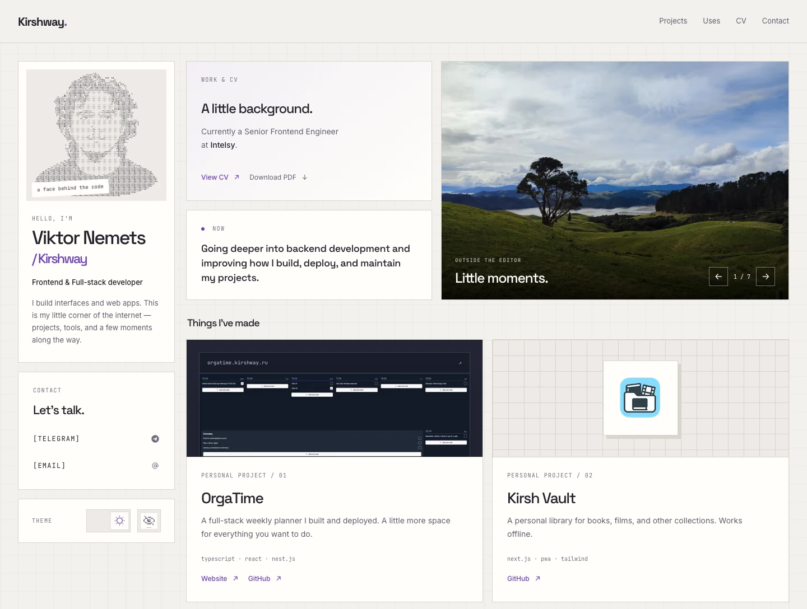

<h1 align="center">Home</h1>

<p align="center">
  A little corner of the internet, by <a href="https://github.com/KirshWay">Viktor Nemets / Kirshway</a>.<br />
  Projects, tools, and moments outside the editor.
</p>

<p align="center">
  <a href="https://kirshway.github.io/home/"><strong>Website ↗</strong></a>
  &nbsp; · &nbsp;
  <a href="#run-locally">Run locally</a>
  &nbsp; · &nbsp;
  <a href="#checks">Checks</a>
</p>

<picture>
  <source media="(prefers-color-scheme: dark)" srcset="assets/readme/preview-dark.webp" />
  <source media="(prefers-color-scheme: light)" srcset="assets/readme/preview-light.webp" />
  
</picture>

<p align="center">
  <a href="assets/readme/preview-light.webp">Light preview</a>
  &nbsp; · &nbsp;
  <a href="assets/readme/preview-dark.webp">Dark preview</a>
</p>

## A personal space

Home brings together what I build, what I work with, and a few things away from the keyboard. Work has its own project cards and CV; photos and small interactions give the page its personal character.

- **A responsive mosaic.** An introduction, selected projects, a photo gallery, current interests, tools, and contact links.
- **Two themes, one identity.** Light and dark palettes with optional scanlines and saved appearance preferences.
- **An interactive ASCII portrait.** A canvas effect with an image fallback, reduced-motion support, and animation that stops when idle or hidden.
- **Native browser interactions.** A popover menu, section highlighting with CSS `:target`, and a gallery built on overflow and Scroll Snap.

Built with [Astro](https://astro.build/), [TypeScript](https://www.typescriptlang.org/), and [Tailwind CSS](https://tailwindcss.com/). Pages are generated as static HTML; small browser scripts handle the interactions that need them. Astro prepares responsive image formats and sizes at build time.

## Run locally

<details>
<summary>Setup and local preview</summary>

Use **Node.js 22.12 or newer** and the **pnpm version in [package.json](package.json)**. CI uses Node.js 24.

```sh
pnpm install
pnpm dev
```

Run these commands from the project directory, then open [localhost:4321/home/](http://localhost:4321/home/). The `/home/` base path applies locally as well as on GitHub Pages.

To inspect the production build:

```sh
pnpm build
pnpm preview
```

Open the preview server's `/home/` URL. The generated site lives in `dist/`.

</details>

## Checks

| Command                 | Purpose                                                     |
| ----------------------- | ----------------------------------------------------------- |
| `pnpm run check`        | Astro templates and TypeScript diagnostics                  |
| `pnpm run lint`         | Linting with Oxlint                                         |
| `pnpm run format:check` | Formatting with Prettier                                    |
| `pnpm test`             | ASCII particle behavior with Node.js's built-in test runner |
| `pnpm build`            | Production build                                            |

Pushes to `main` run the [GitHub Actions workflow](.github/workflows/deploy.yml), which checks, builds, and deploys the site to GitHub Pages.

---

Built and maintained by [Viktor Nemets / Kirshway](https://github.com/KirshWay). Find more projects on [GitHub](https://github.com/KirshWay), or [get in touch](mailto:nemecvictor.kirsh@gmail.com).
